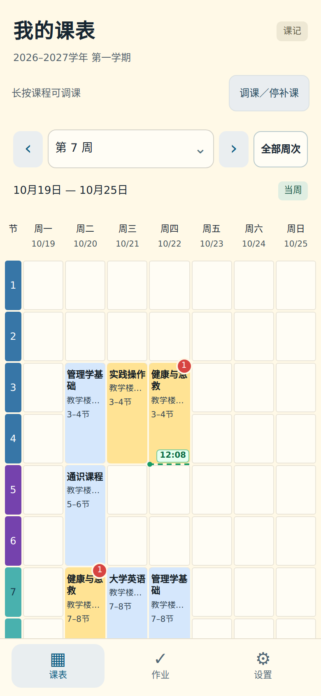
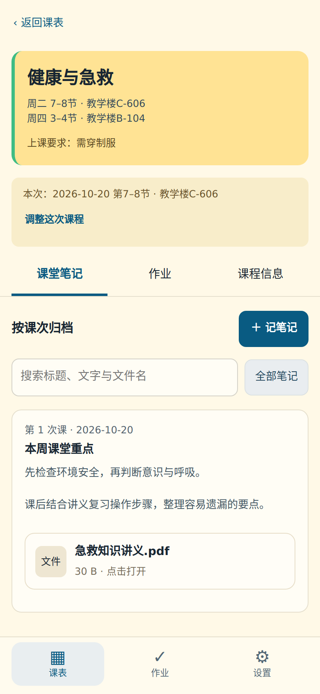

# 课记

把**课表、课堂笔记和作业**放在一起的离线安卓 APP，适合不同学校和专业。

- **看课表**：按周查看课程，支持单双周、调课和停补课。
- **记笔记**：记录课堂重点，添加照片、PDF、Word、PPT 等文件。
- **管作业**：记录截止时间、设置提醒，完成后勾选归档。
- **留资料**：无需账号，资料保存在手机，支持完整备份与迁移。

**[下载最新版 APK](https://github.com/C-makabaka/classnote/releases/latest)** · Android 8.0 及以上

## 界面预览

<p>
  
  
</p>

截图使用示例课程。首次安装为空课表，可自行添加或导入。

## 开始使用

1. 下载并安装 APK；已有版本可直接覆盖升级，保留原有资料。
2. 添加课程，或在“AI / JSON导入”中按提示导入课表。
3. 点击课程，添加笔记、照片、文件附件或作业；需要提醒时允许通知。
4. 在“设置 → 备份与迁移”导出完整备份，方便换机或恢复。

应用无需联网，没有申请互联网权限。界面依赖 Android System WebView，建议 WebView 90 及以上。安装包不绑定 CPU 架构。

## 功能与使用说明

<details>
<summary>笔记、照片与文件附件</summary>

- 笔记支持日期、主题、正文、重点、照片和文件附件，也可只保存照片或文件。
- 在“记笔记 / 编辑笔记 → 文件附件”中点“添加文件”，支持多选；点击已保存的附件，用手机中对应的应用打开。
- 照片与附件复制到应用内，移动或删除外部原文件不影响已保存副本。支持文件名搜索、移除确认和草稿恢复。
- 照片支持左右切换、双击放大与还原、双指缩放和拖动。放大后到达边缘再向外滑，可切换照片；点击照片或空白退出。
- 每个附件最多 64MiB，每条笔记最多 100 个附件。完整 ZIP 备份包含附件原文件与元数据；含附件的备份请用 1.5.0 或更新版本恢复。

</details>

<details>
<summary>AI整理课表与JSON导入</summary>

1. 首页空课表卡片或“设置 → AI / JSON导入”。
2. 点“复制提示词”，去豆包、DeepSeek、ChatGPT等AI应用粘贴，附上课表照片或文字。不要提供不必要的学号等个人信息。
3. 告诉AI第一教学周周一的准确日期和学期总周数；看不清的信息先确认，不应猜测。
4. 把AI输出的完整JSON粘贴回来，点右上角“预览”，检查课程、星期、周数、节次和教室。
5. 确认无误后点右上角“保存”。修改JSON会清除旧预览，需要重新预览。

JSON只添加课程，不清除现有笔记、作业或调课记录。已有资料时，导入的学期起始日和周数必须与当前设置一致；同名课程会被拒绝，修改现有课程请用课程编辑。导入发生格式错误或冲突时，不会保存半份课表。

完整字段与示例见下方开发资料。

</details>

<details>
<summary>调课与停补课</summary>

首页点“调课／停补课”，或者长按具体周次中的课程，打开选择框。长按会直接选中该次课；从课程详情的通用入口进入时，仍需手动选择原课程：

| 情况 | 操作 |
| --- | --- |
| 临时换课 | 选择原课程的具体日期，再选目标日期、节次、教室 |
| 两课对调 | 选择两次具体课程，整体交换日期、节次和教室 |
| 节假日停补课 | 填停课起止日；可同时添加多组“补哪一天 → 实际哪天补” |
| 长期变更 | 选择固定时段、起始周、新星期、节次、教室 |

- 先“预览调整”，检查逐门课的新旧日期；确认后保存。时间冲突会列明具体课程，不保存冲突安排。
- 只停课或只补课均可。补课来源必须是明确日期，单双周和开课周范围按来源日处理；也可以随后给已停课日期补课。
- 补课目标日原有课程保留；若学校同时取消目标日课程，可先停课，再添加补课。来源日期与目标日期交叉的复杂安排请分次处理。
- 长期变更只影响选择的固定时段，保留更早历史及已做的单次调课、对调、补课和停课。
- 具体周次显示实际安排；周一至周日七列自适应排列，不需要横向滑动。原位置空闲时显示灰色卡片；原位置已有其他课时，可展开下方“本周原安排变更”查看。
- “全部周次”显示基础课表，实际调整请选具体周次查看。
- 选择框底部“调整记录”可查看明细并**倒序撤销最近一次**；相关笔记、作业不删除。
- 有调整记录时锁定基础时段及学期起点、周数，防止破坏历史。可继续编辑课程名称、要求、成绩构成，以及添加新课程；如要重新设置整个学期，请先撤销全部调整。
- 点击某次课程后添加笔记，会带入实际上课日期，并保留原定日期。既有笔记不会随调课改写。
- **作业截止时间、应用作业提醒、已保存到系统日历的副本均不会因为调课而改动。**

每学期最多保留200条调整，每条最多1000次课，合计最多20000个变更；所有日期须在设置的学期内。

</details>

<details>
<summary>提醒与日历的区别</summary>

应用提醒会在修改、完成、删除作业时重新安排或取消。没有精确提醒权限时使用系统允许的近似提醒；通知权限、系统省电和厂商后台限制仍会影响送达。若提前提醒时刻已过去、但截止时间尚未来到，会尽快提醒一次；截止已经过去则只标示逾期，不反复补发。

系统日历事件是你另外保存的一份副本。本应用不会读取系统日历，也不会宣称已替你完成日历保存；后续修改作业需自行修改那份日历事件。

</details>

<details>
<summary>当前时间线</summary>

课表去掉课程左侧绿条，当前周的今天一列显示绿色虚线和时间。使用手机本地时间，每0.25秒更新并平滑衔接，回前台立即校准；跟随系统减少动态效果设置。上课时间在节次内按比例定位，课间/午休在相邻节次间的小间隙移动，不拉长课表。早于08:00或晚于22:30时默认隐藏；修改作息后按新范围显示。其他周和全部周次不显示。
设置→设置每节课的时间，可修改14节课的上下课时间；右上角保存。默认采用提供的作息表，时间随ZIP完整备份保存。

</details>

<details>
<summary>界面与图标</summary>

- 课表固定显示周一至周日，按手机宽度分配七列，周末有课也不需要横向滑动。课程标题保持深色粗体；过长的标题与教室信息在卡片内截断，点击可看完整信息。
- 选择面板和编辑页有进入／退出动画；开启减少动态效果时尊重系统设置。点击选择面板外的遮罩空白处可以关闭，面板内空白不会误触关闭。
- 下拉选项改为应用内淡黄色选择面板，选中项淡蓝高亮；选项较多时提供搜索。手机返回键先关闭选项面板，再返回调课页。
- 调课使用完整编辑页，采用与笔记、作业、课程信息相同的顶部栏。左上返回，右上保存；滚动长表单时顶部栏保持可见。
- 笔记、作业、课程与学期设置不再需要滑到底部保存。调课右上角先“预览”，预览成功后变为“保存”；再次修改内容时要求重新预览。
- 书本前景已生成透明背景，系统自适应图标采用白底并增加留白，应用信息、圆形图标与桌面入口使用统一资源。旧图标资源已移除。若覆盖安装后个别系统界面仍显示旧图标，可先重启手机刷新缓存；不要为换图标直接卸载，以免丢失本机资料。
- 本版继续沿用原签名，可直接覆盖1.0、1.1或1.2，保留本机资料。

</details>

<details>
<summary>完整功能列表</summary>

- 淡黄色课表、近黑粗体课程名、蓝色普通课程、黄色制服课程、绿色侧边与原图节次配色。
- 红色数字表示这门课全部未完成作业数，同一门课多个时段共享计数。
- 上下周、指定周、全部周次、回到当周，以及周起止日期和每天日期；支持单双周。
- 首次启动不预置任何课程；可导入、添加、编辑和归档课程，支持多个时段和周末排课。
- 自由填写课堂要求、任课教师、成绩构成与其他备注；制服要求以详情小字显示。
- 课堂笔记：课次、日期、主题、正文、重点、多张照片、排序、图片查看和放大、文字与附件名搜索、文件附件。
- 作业：自动建议序号、要求、截止时间、提交方式、备注、图片、自定义提前提醒。无截止时间也能保存。
- 完成作业变灰、标题划线、沉底，历史可打开编辑，也能恢复成待完成。
- 原生相册选择／系统相机，照片复制进应用；删除相册原图不影响应用内副本。
- 应用提醒、通知权限和精确提醒设置；重启、时间调整和应用升级后重新安排待办提醒。
- 一键打开系统日历的新建事件页面，预填作业信息和截止时间，用户在日历内确认保存。
- 完整ZIP导出／恢复，包括文字记录、照片和文件附件；结构与文件校验、暂存和原子替换、失败保留旧资料。
- 有修改时自动保留草稿；启动不弹窗，点击首页右上角或设置中的“草稿”继续。离开编辑时可选“保存草稿”“放弃修改”“继续编辑”；未修改直接返回。当前保留一份草稿，新建前会提示处理已有草稿，避免覆盖。照片接收结果在草稿保存后才确认。

“全部周次”中同一时段有多个不同周课程时，会显示“分周课程”，点击展开查看所有安排。

</details>

## 开发资料

| 项目 | 参数 |
| --- | --- |
| 当前版本 | 1.5.1 · versionCode 13 |
| 包名 | `cn.cbhcool.classnote` |
| Android | minSdk 26 · targetSdk / compileSdk 35 |
| 界面 | 本地 HTML / CSS / JavaScript + Android WebView |
| 原生部分 | Java，文件、照片、提醒、日历与 WebView 桥接 |
| 图片预览 | PhotoSwipe 5.4.4，离线打包，MIT |
| 构建环境 | JDK 17 · Android SDK 35；Linux 构建另需 Python 3 |

### 数据和备份边界

- 记录和原图保存在应用私有目录。卸载会删除这些资料；应用未启用系统自动云备份。
- 单张照片最多40MB；每条笔记／作业最多100张图片。
- 单个文件附件最多64MiB；每条笔记最多100个附件。
- 文字记录文件最多8MiB（UTF-8），照片另存，不占该限额。超限保存会明确失败并保留上一个版本。
- 完整备份最多2GiB展开数据、30000个文件；导出与导入使用一致上限，不生成已知无法恢复的超限备份。
- 恢复会替换现有资料，请先导出当前备份。不同schema版本或缺失照片的备份会被拒绝。
- 共享预留使用墓碑删除记录；普通界面不显示删除记录。备份可能包含这些历史记录及未再引用的图片。

### 开发结构

```text
app/src/main/assets/       本地界面、领域层、空白初始数据、JSON导入、平台接口
app/src/main/java/         Android文件、照片、提醒、日历、WebView桥接
app/src/main/res/          应用图标、通知图标、主题
tests/                    JS领域测试、浏览器流程、Java归档与验证测试
docs/SHARING.md            多人共享框架、协议与服务端伪代码
docs/TESTING.md            已验证范围与真机检查项
docs/superpowers/          已批准需求与实施记录
scripts/build.py          无Gradle的Linux构建器
signing/personal.jks       本项目个人版本签名密钥（本机保管，不纳入GitHub或新源码包）
```

### 再次构建

**Windows／Android Studio：** 解压源码，用Android Studio打开根目录；安装SDK35并使用JDK17。命令行也可运行 `gradlew.bat assembleRelease`，成品位于 `app/build/outputs/apk/release/`。首次需要下载Gradle和Android插件。

**Linux／WSL：** 安装Java17运行时与Python3，运行：

```bash
python3 scripts/build.py
```

脚本下载并校验固定版本的官方SDK35工具和Eclipse Java编译器，成品位于 `build/manual/classnote-1.5.1.apk`。本次交付APK实际使用此路径构建，Android Studio路径提供了配置但没有在当前环境另行下载Gradle完成构建。

这是个人测试版本。本次交付APK沿用原签名，新的源码包与GitHub提交均排除签名密钥。请继续妥善保管旧版本私有存档中的 `signing/personal.jks`，保留原密钥才能自行构建可覆盖升级的版本；未配置原密钥时构建脚本会创建新的个人开发签名。若丢失原密钥，应先导出备份再换签名安装。发布公开产品时请建立独立的正式签名方案。

### 多人共享

本版**没有启用多人同步**。记录已含UUID、ownerId、spaceId、revision、updatedAt、deletedAt；共享接口在 `sharing.js` 中显式禁用。`docs/SHARING.md` 给出以后接入同学共享时的成员权限、版本冲突、照片同步以及个人作业完成状态分离的实现边界。

### 课表 JSON 字段

| 字段 | 说明 |
| --- | --- |
| format / version | 固定为 `classnote-timetable` / 数字 `1` |
| semester.name | 学期名称 |
| semester.startDate | 第一教学周的周一，`YYYY-MM-DD` |
| semester.weeks | 学期周数，整数1–52 |
| courses | 课程数组，每次1–100门 |
| name / shortName / teacher | 完整课程名、简称、教师；name必填 |
| uniform | 是否明确要求制服，布尔值true或false |
| requirements / grading / remarks | 课程要求、成绩构成、备注文字，可留空 |
| lessons | 该课程的固定上课时段数组，每门1–100个 |
| day | 星期一至日，对应整数1–7 |
| start / end | 起止节次，整数1–14，包含结束节 |
| fromWeek / toWeek | 起止周，均为整数，不能超出学期 |
| parity | `all`每周、`odd`单周、`even`双周 |
| room | 教室，可为空字符串 |

不连续周可分成多个时段。例如仅第3周上课，fromWeek与toWeek都填3。完整示例见源码中的 `docs/timetable-example.json`；不要把示例课程和日期当作自己的真实课表。

### 源码、签名与验证

GitHub 源码不包含签名密钥或用户资料。测试夹具使用示例课程和教室。自行构建需要配置签名；缺少原签名时，新 APK 不能覆盖已安装的原版。覆盖升级请下载发布页中的 APK。

- [验证记录与测试命令](docs/TESTING.md)
- [历史更新](docs/CHANGELOG.md)
- [第三方组件与重建方法](docs/THIRD_PARTY.md)
- [课表 JSON 示例](docs/timetable-example.json)
- [共享协议设计](docs/SHARING.md)

系统能力参考：[Android 提醒机制](https://developer.android.com/develop/background-work/services/alarms)、[系统日历交互](https://developer.android.com/identity/providers/calendar-provider)、[应用内内容加载](https://developer.android.com/develop/ui/views/layout/webapps/load-local-content)。
